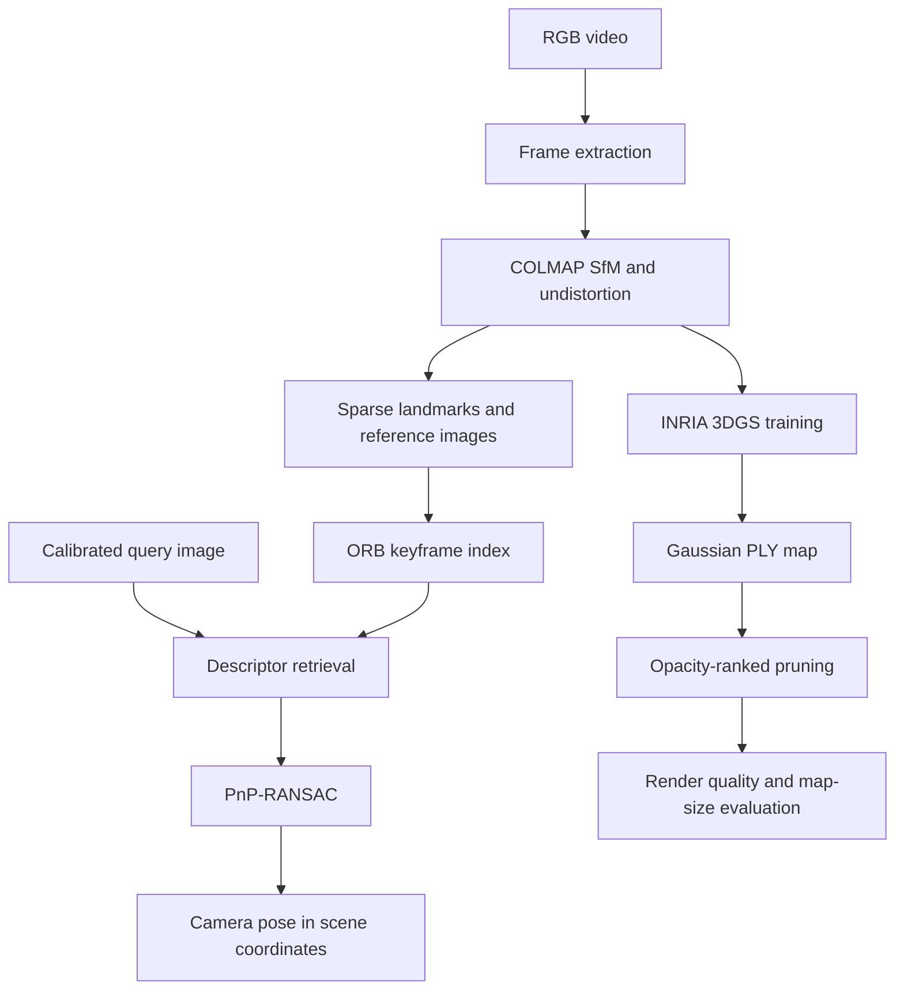

# MobileGS Rover

**Video-based 3D reconstruction, Gaussian map compression and visual relocalisation**

MobileGS is a research-oriented prototype exploring how RGB sequences acquired by a mobile camera can be transformed into a compact 3D Gaussian map and used for camera relocalisation. The pipeline combines COLMAP structure from motion, the original INRIA 3D Gaussian Splatting implementation, and Python modules for map pruning, feature matching and pose estimation.

This repository is a cleaned reconstruction of the original February 2026 experiment. The additional compression, localisation, capture and evaluation modules are newly reconstructed implementations, not a recovered copy of the original rover software. Their real-scene and edge-device validation remains open.

## Architecture



The visual localisation branch uses COLMAP's sparse landmarks, not the Gaussian centroids. The compressed Gaussian map is intended for rendering and storage; this implementation does not perform Gaussian-based pose optimisation or online SLAM.

## Recorded reconstruction experiment

| Quantity | Recorded value |
|---|---:|
| Input video duration | 15.86 s |
| Frame extraction rate | 3 FPS |
| Registered images | 48 |
| Initial sparse 3D points | 7,495 |
| Training iterations | 7,000 |
| Training PSNR at iteration 7,000 | 34.78 dB |
| Rendered training views | 48 |

Source: the original Colab notebook output dated 20 February 2026. See [recorded experiment](docs/RECORDED_EXPERIMENT.md) for log excerpts and provenance. The PSNR is a **training-set** measurement; no held-out result is recorded in that run. Input media and the trained map are not included in this release.

## Repository layout

| Directory | Purpose |
|---|---|
| `mapping/` | Video extraction, COLMAP, optional external 3DGS training/rendering |
| `compression/` | Opacity-ranked pruning of binary Gaussian PLY files |
| `localization/` | ORB keyframe matching, 2D–3D association and PnP-RANSAC |
| `deployment/` | Generic OpenCV camera capture utility |
| `benchmarks/` | Paired-image PSNR and pose-error evaluation |
| `notebooks/` | Clean reproduction entry point for the historical workflow |
| `tests/` | Synthetic component tests |
| `docs/` | Provenance, experimental protocol and limitations |

## Installation

Python 3.10+ on Linux is recommended for the full mapping workflow. The independent CPU modules and tests also work on Windows with Python and OpenCV. The mapping CLI follows the flags used by **COLMAP 3.7**; other COLMAP versions may require changes.

```bash
python -m venv .venv
source .venv/bin/activate  # Windows PowerShell: .venv\Scripts\Activate.ps1
python -m pip install -r requirements.txt
python -m pytest -q
```

For reconstruction, install FFmpeg and COLMAP (e.g. Ubuntu 22.04):

```bash
sudo apt-get update
sudo apt-get install -y ffmpeg colmap
```

For Gaussian training/rendering, use a CUDA-capable environment and install the official [INRIA Gaussian Splatting](https://github.com/graphdeco-inria/gaussian-splatting) checkout according to its upstream instructions. Use its Python environment to run the mapping CLI and install this repository's requirements there if needed. The external checkout and CUDA extensions are not bundled here. The historical notebook did not record the top-level upstream commit, so exact version reproduction is not guaranteed.

## Usage

Run commands from this repository root. Paths are examples; supply your own input data and calibration. Use a new workspace for every mapping run.

**1. Capture or supply a video**

```bash
python -m deployment.capture --device 0 --output room.mp4 --seconds 20
```

The capture helper uses a generic OpenCV camera. Jetson CSI cameras may require a separate GStreamer pipeline. No motor-control or hardware-specific integration is provided.

**2. Reconstruct and train**

```bash
python -m mapping.reconstruct --video room.mp4 --workspace runs/room --gs-repo /path/to/gaussian-splatting --fps 3 --iterations 7000 --eval
```

Omit `--gs-repo` for SfM-only processing. Omit `--eval` to reproduce the original all-training-view experiment rather than request the upstream held-out split. The workspace stores extracted frames, the undistorted COLMAP model, a text model for localisation and (if enabled) the trained Gaussian model. Upstream's evaluation split is for novel-view rendering; COLMAP is still estimated from the input sequence.

**3. Prune a trained map**

```bash
python -m compression.prune runs/room/gs_output/point_cloud/iteration_7000/point_cloud.ply runs/room/pruned.ply --fraction 0.6
```

This removes the lowest-opacity 60% (rounded down) of Gaussian vertices and reports actual input/output PLY bytes. All retained vertex properties are preserved. A chosen pruning ratio is not proof of equivalent GPU memory savings or preserved reconstruction quality. See the [evaluation protocol](docs/VALIDATION.md) for rendering the pruned checkpoint.

**4. Relocalise an independent query image**

Copy `configs/camera.example.json` and replace its illustrative intrinsics, distortion and image dimensions with actual calibration for your query camera. The keyframe index uses the undistorted reference images and their matching COLMAP tracks. Use a query image not present in those references for meaningful evaluation.

```bash
python -m localization.relocalize --model runs/room/colmap_text --images runs/room/undistorted/images --query query.png --camera camera.json --output pose.json
```

The result includes the world-to-camera rotation and translation, camera centre, inlier count and median reprojection error, or a failure result. Position is in COLMAP scene units unless calibrated to metric scale.

**5. Evaluate**

```bash
python -m benchmarks.evaluate images --reference runs/room/gs_output/test/ours_7000/gt --renders runs/room/gs_output/test/ours_7000/renders
python -m benchmarks.evaluate pose --prediction pose.json --truth ground_truth.json --meters-per-unit 0.25
```

The scale above is illustrative, not measured. Ground truth must already be in the same coordinate frame; the evaluator does not align trajectories. See the [validation protocol](docs/VALIDATION.md).

## Validation status

| Component | Status |
|---|---|
| Original SfM + 3DGS | Historical Colab logs available |
| Refactored mapping CLI | Command orchestration checked with mocked dependencies; GPU run not performed |
| PLY pruning | Synthetic binary round-trip tested |
| ORB + PnP | Synthetic same-image retrieval and pose recovery with outliers tested |
| Real-world relocalisation, held-out image quality | Pending scene data and ground truth |
| Jetson capture, runtime and memory | Pending hardware validation |

## References and attribution

- Kerbl et al., *3D Gaussian Splatting for Real-Time Radiance Field Rendering*, ACM TOG (2023). [Official implementation and license](https://github.com/graphdeco-inria/gaussian-splatting).
- Schönberger and Frahm, *Structure-from-Motion Revisited*, CVPR (2016). [COLMAP](https://colmap.github.io/).
- Rublee et al., *ORB: An Efficient Alternative to SIFT or SURF*, ICCV (2011). ORB and PnP are provided by [OpenCV](https://opencv.org/).

Third-party software remains subject to its own license. The external INRIA implementation is not redistributed or claimed as original work here.
